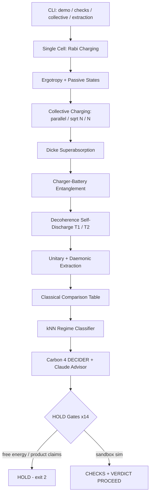
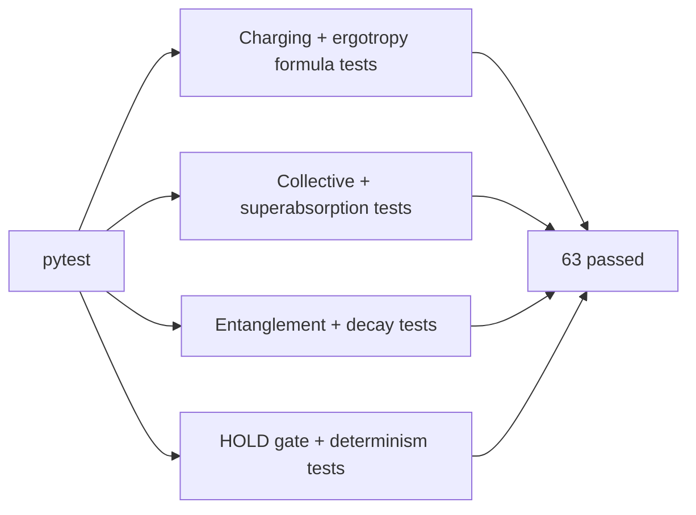
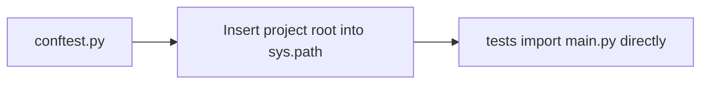
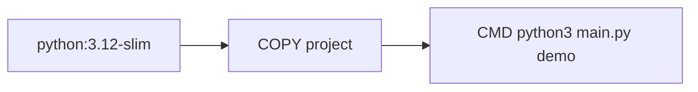

# QuantumBattery-Lab 🔋⚛️

**Quantum Battery Charging & Ergotropy Lab** — by Darion Kellar

## ❓ What is this?

QuantumBattery-Lab is an **educational quantum battery physics lab** in ONE pure-Python file. It models how a battery made of two-level quantum systems (atoms, molecules, superconducting qubits) charges, stores energy, and gives work back — using **real formulas**: Rabi charging, **ergotropy** (the maximum work a unitary can extract), **collective charging advantage** (with both the √N and N scalings shown honestly, side by side, with their assumptions), **Dicke superabsorption**, charger–battery **entanglement**, **decoherence self-discharge**, and **daemonic ergotropy**. ⚛️

Honest scope, stated up front: quantum batteries are **real published research** (Alicki & Fannes 2013; the Quach et al. 2022 superabsorption device), **not a product**. Lab devices store microjoule-scale energy. This lab sells nothing, powers nothing, and breaks no thermodynamics — every free-energy / product / live-hardware claim sits behind a permanent HOLD gate (14 total). 🔒

## 🧰 Tech Stack Badges & Full Architecture


> ℹ️ Workflow badges are static **'Pending Paste'** shields on purpose: the `ci.yml` and `docker-publish.yml` files are delivered in the local paste pack and are **not pasted yet**, so no live badge is claimed.

**📦 1. Language & Runtime**
- 🐍 Python 3.12, pure standard library (`math`, `hashlib`, `json`, `sys`)
- 🚫 Zero dependencies, zero network, deterministic (double-run byte-identical)

**⚛️ 2. Physics Core**
- 🔋 Two-level cell charging (Rabi rotation), ergotropy + passive states (Bloch-vector formula)
- 👥 Collective charging: parallel vs Dicke √N vs global-entangling N — assumptions printed with every number
- ✨ Dicke superabsorption (rate ×N, total power ×N²), charger–battery concurrence, T1/T2 decay, daemonic ergotropy

**🤖 3. AI / ML**
- 🧠 TinyML kNN regime classifier (from scratch, stdlib): unitary-optimal / decoherence-limited / extraction-limited
- 🔮 Gemini Carbon 4 DECIDER seat (names-only, tighten-only) + Muse advisor (never overrides HOLD)

**🎬 4. Media / Planning**
- 🎥 Google Flow plan-only seat (rendered = False, live = 0)

**🐳 5. Infrastructure**
- 🐳 Docker (`python:3.12-slim`), GitHub Actions CI + Docker Publish (paste pack)
- 🎯 Target image: `credkellar/quantumbattery-lab:latest`

**🔒 6. Safety**
- ⛔ 14 HOLD gates — free-energy claims, perpetual motion, product claims, live hardware, and more are permanently held

## 🔬 What this does

1. 🔋 **Single-cell charging** — a two-level cell under a resonant drive: population `sin²(Ωt/2)`, stored energy, full-charge time `π/Ω`, average and peak charging power.
2. ⚖️ **Ergotropy** — the maximum unitarily extractable work, computed from the Bloch vector: `W = gap·(rz + |r|)/2`. Ground states, passive states, and maximally mixed states all correctly give **zero**; a pure superposition gives back everything.
3. 👥 **Collective charging advantage** — N cells three ways: parallel (×1), Dicke collective drive (×√N), global entangling unitary (×N). Both quantum scalings are shown **with the assumption that buys each one** — the N result needs a charger whose drive norm grows with N.
4. ✨ **Superabsorption** — Dicke bright-state physics: transition rate ×N, per-cell absorbed power ×N, total power ×N², and the ensemble charge time — the effect demonstrated by Quach et al. (2022).
5. 🔗 **Charger–battery entanglement** — an excitation-swap model where concurrence is `|sin(2gt)|`: entanglement peaks at **half charge** and is exactly zero at full charge. A companion, not the product.
6. 📉 **Decoherence / self-discharge** — amplitude damping (T1) and dephasing (T2) eat the stored energy and the ergotropy (ergotropy dies faster when coherence matters), benchmarked against a Li-ion cell's ~2%/month self-discharge.
7. 😈 **Work extraction + daemonic ergotropy** — ideal unitary extraction recovers exactly the ergotropy; measuring a correlated ancilla raises the average extractable work (daemonic gain ≥ 0, computed for every p) — and the demon pays Landauer costs, so the second law is safe.
8. 📊 **Classical comparison** — lead-acid, supercapacitor, Li-ion (250 Wh/kg, a real product) vs the quantum battery's per-molecule **theoretical** ~536 Wh/kg — clearly labeled theory, with the lab reality (~µJ total) printed next to it.
9. 🏷️ **Regime classifier** — a from-scratch kNN labels a charging setup `unitary-optimal` / `decoherence-limited` / `extraction-limited` from its noise and loss features.
10. 🧠 **Advisory seats + checks** — Carbon 4 DECIDER with sha256 trace, Muse advisor, Google Flow plan-only, and a built-in CHECKS suite (48 checks).

## 🗺️ How it works — diagram per script

### `main.py` — the whole lab



### `tests/test_main.py` — verification



### `conftest.py` — test path setup



### `Dockerfile` — container



## 🤩 Why is this cool?

1. 🔋 A whole research field — charging, storage, extraction — in ONE dependency-free file.
2. ⚖️ Ergotropy is computed exactly, and the lab proves passive states give back **zero** work, every time.
3. 👥 The famous collective-charging advantage is shown **both ways** (√N and N) with the price tag of each assumption printed next to it.
4. ✨ Superabsorption's N² total power falls out of one Dicke rate formula you can check by hand.
5. 🔗 It shows the entanglement–charging tradeoff honestly: maximum entanglement happens at half charge, not full.
6. 📉 Decoherence is not hand-waved: T1/T2 decay curves sit right next to a Li-ion self-discharge baseline.
7. 😈 Daemonic ergotropy — a measurement-powered "demon" that legally extracts more work — is computed, not just described.
8. 📊 The classical comparison table refuses to hype: theoretical Wh/kg and microjoule lab reality in the same row.
9. 🔒 14 HOLD gates make the anti-hype boundary part of the code: free energy, perpetual motion, and product claims all exit 2.
10. 🎯 Deterministic end to end: run it twice, get byte-identical output — science you can diff.

## 🛠️ What problems this solves?

1. ❌ **Problem:** Quantum battery headlines promise free energy and instant EV charging. ✅ **Solution:** Every claim is a formula with a test; free-energy and product claims are HOLD gates.
2. ❌ **Problem:** The "quantum charging advantage" is quoted as one magic number. ✅ **Solution:** Three models side by side — ×1, ×√N, ×N — each with its assumption and caveat.
3. ❌ **Problem:** Stored energy and extractable work get treated as the same thing. ✅ **Solution:** Ergotropy vs passive-state energy is computed separately for every state.
4. ❌ **Problem:** Superabsorption is described as magic light-soaking. ✅ **Solution:** It is reduced to the Dicke bright-state rate (×N) and its N² power consequence.
5. ❌ **Problem:** People assume entanglement is what gets stored. ✅ **Solution:** The swap model shows concurrence peaking at half charge and vanishing at full charge.
6. ❌ **Problem:** Quantum self-discharge is ignored in popular accounts. ✅ **Solution:** T1/T2 decay is modeled and benchmarked against Li-ion's 2%/month.
7. ❌ **Problem:** Daemonic ergotropy sounds like a second-law violation. ✅ **Solution:** The gain is computed exactly and the Landauer cost is stated with it.
8. ❌ **Problem:** Theoretical energy density gets compared to products unfairly. ✅ **Solution:** The comparison table labels theory as theory and prints the µJ lab scale.
9. ❌ **Problem:** Physics code usually needs numpy / scipy installs. ✅ **Solution:** Pure standard library — runs anywhere Python 3.12 runs, zero pip installs.
10. ❌ **Problem:** Simulation tools quietly imply a product is around the corner. ✅ **Solution:** 14 named HOLD gates return exit code 2 for every product / live claim, forever.

## 📥 How to install step-by-step

1. 📋 Clone or download this project folder.
2. 🐍 Make sure Python 3.12+ is installed: `python3 --version`
3. ▶️ Run the full demo + checks (no arguments needed):

```bash
python3 main.py
```

4. 🧪 Run the test suite:

```bash
pip install pytest
python3 -m pytest -q
```

5. 🎛️ Try the other commands:

```bash
python3 main.py checks          # 48 built-in checks
python3 main.py collective      # 16 cells, 3 charging models compared
python3 main.py superabsorption # Dicke rate / power scaling table
python3 main.py discharge       # T1/T2 self-discharge curves
python3 main.py extraction      # unitary + daemonic extraction
python3 main.py compare         # classical vs theoretical table
python3 main.py classify        # kNN regime report
python3 main.py brains          # Carbon 4 + Muse + Flow seats
python3 main.py holds           # list all 14 HOLD gates
python3 main.py hold-demo       # exits 2 - gated claims stay HOLD
```

6. 🐳 Or run it in Docker:

```bash
docker build -t credkellar/quantumbattery-lab:latest .
docker run --rm credkellar/quantumbattery-lab:latest
```

## 📋 Requirements

- 🐍 Python 3.12 or newer
- 📦 Dependencies: **none** (standard library only)
- 🌐 Network: **none** — fully offline
- 🧪 For tests only: `pytest`
- 🐳 Optional: Docker

## 🧒 5th-grade English section

Imagine a tiny battery so small it is just **one atom with two shelves**. 🔋

- To charge it, you shine a special light that lifts energy from the bottom shelf to the top shelf. The math in this project tells exactly how long that takes. 🔦
- Not all stored energy can come back out as work. The part that **can** come out has a name: **ergotropy**. The part that is stuck is called the **passive** part. It is like a piggy bank where some coins are glued down. 🐷
- If you charge **many tiny batteries together as a team**, they can charge faster than one by itself — the team shares the light. Scientists really measured this in 2022! 👥✨
- While it charges, the battery and its charger hold hands in a spooky quantum way called **entanglement** — but they let go exactly when the battery is full. 🔗
- If you wait too long, the energy **leaks away** all by itself, like air from a balloon. This project draws that leak and compares it to a normal phone battery. 📉
- A clever helper called a **demon** can peek at a friend atom and squeeze out a little extra work — but peeking has its own cost, so no rules of nature are broken. 😈
- This project is a **pretend lab on a computer**. Quantum batteries are real science experiments, but they are super tiny and **not** something you can buy. Nobody is powering a car with one. 💻

## 🌳 Full file tree

```text
quantum-battery-lab/
├── main.py                  # the whole lab: charging, ergotropy, collective, superabsorption, decay, daemon, seats, HOLD gates
├── conftest.py              # puts the project root on sys.path for tests
├── tests/
│   └── test_main.py         # 63 pytest tests: formulas, collective scaling, entanglement, gates, determinism
├── assets/
│   └── cover.png            # README cover image (2736 x 912)
├── Dockerfile               # python:3.12-slim, runs the demo
└── README.md                # this file
```

> 📦 Delivered separately as paste packs (not in this tree): `.github/workflows/ci.yml` + `docker-publish.yml`, and the Docker Hub pack (100-char description, 350-char About, overview, categories).

---

MIT © 2026 Darion Kellar · QuantumBattery-Lab — educational simulation only 🔋
